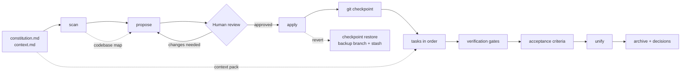

<p align="center">
  
</p>

<h1 align="center">SpecVibe</h1>

<p align="center">
  <strong>Spec-driven governance for AI coding agents.</strong><br/>
  Your agent writes code fast. SpecVibe makes sure it writes the right code,<br/>
  in the right order, with a checkpoint and a way back.
</p>

<p align="center">
  <a href="https://www.npmjs.com/package/specvibe"></a>
  <a href="https://www.npmjs.com/package/specvibe"></a>
  <a href="https://github.com/bayazid-k-product/specvibe/actions/workflows/ci.yml"></a>
  <a href="LICENSE"></a>
  <a href="https://nodejs.org">= 22.12" /></a>
</p>

<p align="center">
  <a href="#quick-start">Quick start</a> ·
  <a href="#how-it-works">How it works</a> ·
  <a href="#agent-integrations">Agents</a> ·
  <a href="#commands">Commands</a> ·
  <a href="#configuration">Configuration</a> ·
  <a href="docs/">Docs</a>
</p>

---

## Why this exists

AI agents are excellent at producing code and terrible at remembering why. They forget the architecture, duplicate helpers, skip tests, rewrite files you did not ask them to touch, and leave you with no clean way to undo a bad afternoon.

I wrote SpecVibe after the third time an agent "finished" a feature I never asked for, in a file I had just cleaned up. The answer was not a better prompt — it was writing the plan down, in the repository, where it can be reviewed before anyone types a line of code. That is all this tool is: a small, boring, local-first layer that turns intent into a contract the agent has to follow, and gives you a way back when it does not.

SpecVibe gives every agent the same repository contract:

- a **constitution** that states the non-negotiable rules,
- a **scan** of what already exists,
- a **track** that must be reviewed and approved before implementation,
- an **ordered task list with verification gates**,
- an **acceptance checklist** that cannot be skipped silently,
- a **git checkpoint** before work starts, and a **safe revert** if it goes wrong,
- **native instruction and command files** for the agent you already use.

It is a zero-config CLI with **zero runtime dependencies**, built for Windows, macOS, and Linux.

## Why SpecVibe?

| Without SpecVibe                              | With SpecVibe                                                                                           |
| --------------------------------------------- | ------------------------------------------------------------------------------------------------------- |
| Prompt rules live in a chat that disappears   | A versioned constitution and project context live in the repo                                           |
| The agent plans and codes in one step         | Planning is a separate artifact; code starts only after human approval                                  |
| The agent guesses at existing code            | A deterministic scan maps files, symbols, size violations, and reuse candidates                         |
| "Done" means the agent said so                | Done means every task, gate, and acceptance criterion is checked with evidence                          |
| Undoing a bad change is archaeology           | Apply creates a git checkpoint; revert creates a backup branch and archives the track                   |
| Every agent needs its own hand-written config | One command generates native files for OpenCode, Claude Code, Cursor, Gemini CLI, Windsurf, and Copilot |
| Whole-repo context burns tokens               | `pack` builds a token-budgeted context pack from the constitution, track, and relevant files            |

No telemetry. No network calls. No runtime packages. Everything is stored as plain Markdown and JSON under `.specvibe/`.

## Quick start

Requires **Node.js >= 22.12.0** and, for checkpoints/revert, **Git**.

```bash
# In an existing repository
npx specvibe init

# Or install it once
npm install -g specvibe
sv init
```

`init` detects your stack and existing agent integrations, writes `.specvibe/`, scans the repository, and generates the right instruction and command files. Review the generated constitution and context, then plan your first feature:

```bash
specvibe propose "Add CSV export to the reports page"
```

The command creates a reviewable track under `.specvibe/tracks/add-csv-export/` and **writes no implementation code**. Fill in every `[NEEDS CLARIFICATION]` marker, then validate:

```bash
specvibe approve add-csv-export --check
```

A human reviews the plan and explicitly approves it:

```bash
specvibe approve add-csv-export
```

Implementation starts with a checkpoint:

```bash
specvibe apply add-csv-export
```

The agent works through tasks in order. Gates require evidence and explicit confirmation:

```bash
specvibe apply add-csv-export --next
specvibe apply add-csv-export --done T1
specvibe apply add-csv-export --done G1 --confirm-gate
specvibe apply add-csv-export --accept AC-1
```

When everything is verified:

```bash
specvibe unify add-csv-export
```

The track is archived, its decisions are appended to `.specvibe/decisions.md`, and the active track is cleared.

If the work goes sideways, preview a rollback and then execute it:

```bash
specvibe revert add-csv-export        # dry run: shows commits, files, and dirty state
specvibe revert add-csv-export --yes  # backup branch + stash + reset + archive
```

## Let your agent install it

The fastest way to try SpecVibe is to let the agent you already use set it up. There is **one prompt**, not one per tool: the setup runs through the CLI, so the same text works in OpenCode, Claude Code, Cursor, Gemini CLI, Windsurf, Copilot Chat, or anything else with a terminal.

Paste this into your agent and send it as-is:

```text
Set up SpecVibe in this repository.

1. Read https://github.com/bayazid-k-product/specvibe and docs/getting-started.md
   so you know what the tool does before touching this repo.
2. Confirm Node.js >= 22.12.0 and git are available, then run
   `npx specvibe@latest init` from the repository root.
3. Read the generated .specvibe/README.md, constitution.md, and context.md.
4. Report back: the detected stack, the scan summary, and which agent files
   were generated. Do not write feature code, do not start a track, and do
   not commit.
5. Tell me the single command I should run next, then stop and wait.
```

| Agent                | Where to paste it                             |
| -------------------- | --------------------------------------------- |
| **OpenCode**         | `opencode` in the repo, then the prompt input |
| **Claude Code**      | `claude` in the repo, then the prompt input   |
| **Cursor**           | Chat panel (`Cmd/Ctrl + L`)                   |
| **Gemini CLI**       | `gemini` in the repo, then the prompt input   |
| **Windsurf / Devin** | Cascade panel                                 |
| **GitHub Copilot**   | Copilot Chat panel                            |
| **Anything else**    | Any chat that can run terminal commands       |

What the prompt tells the agent **not** to do matters as much as the rest. It may inspect and initialize; it may not write feature code, commit, or invent decisions on your behalf. Review the generated `.specvibe/` files before you approve anything.

After `init`, the same agent gets native commands — `/sv:propose`, `/sv:apply`, `/sv:unify`, and the rest — so the following steps are a few keystrokes instead of paragraphs.

Prefer to keep the install to yourself? `npx specvibe init` does exactly the same thing. The prompt just saves you the typing.

## How it works



The enforcement points are deliberate:

1. **No feature code before approval.** `propose` only writes planning documents. `apply` rejects any track that is not approved.
2. **No silent task skipping.** Tasks are completed in order unless `--force` is used for one item. Gates always require `--confirm-gate`.
3. **No accidental "done".** `unify` refuses while tasks, gates, or acceptance criteria remain unchecked.
4. **No blind start.** The first `apply` requires a git repository, a commit, and a clean working tree by default. SpecVibe's own bookkeeping under `.specvibe/` is exempt.
5. **No unrecoverable rollback.** Revert creates a `specvibe-backup/<slug>-<timestamp>` branch and stashes dirty/untracked work before resetting.

## Agent integrations

One generated source of truth, native files for each host. SpecVibe never duplicates the full constitution into every command; generated files point to `.specvibe/` and the CLI.

| Agent                | Instructions                                       | Native command files                              | Example invocation   |
| -------------------- | -------------------------------------------------- | ------------------------------------------------- | -------------------- |
| **OpenCode**         | `AGENTS.md`                                        | `.opencode/commands/sv/<name>.md`                 | `/sv/propose`        |
| **Claude Code**      | `CLAUDE.md` + `AGENTS.md`                          | `.claude/commands/sv/<name>.md`                   | `/sv:propose`        |
| **Cursor**           | `.cursor/rules/specvibe.mdc`, `.cursorrules`       | `.cursor/skills/sv-<name>/SKILL.md`               | skill `sv-propose`   |
| **Gemini CLI**       | `GEMINI.md` + `AGENTS.md`                          | `.gemini/commands/sv/<name>.toml`                 | `/sv:propose`        |
| **Windsurf / Devin** | `.windsurf/rules/specvibe.md` (or `.devin/rules/`) | `.windsurf/workflows/sv-<name>.md` (or `.devin/`) | `/sv-propose`        |
| **GitHub Copilot**   | `.github/copilot-instructions.md`                  | `.github/prompts/sv-<name>.prompt.md`             | `/sv-propose` prompt |
| **Generic**          | `AGENTS.md`                                        | —                                                 | Use the CLI directly |

Commands are generated for `setup`, `scan`, `propose`, `plan`, `apply`, `unify`, `pack`, `status`, and `revert`.

Agent behavior is intentionally conservative:

- Follow the constitution and approved spec; do not invent files or symbols.
- Reuse existing code before creating new code.
- Stop at gates and report real command output.
- Ask before using `--force`, `--allow-dirty`, `--allow-no-git`, or `revert --yes`.
- Do not commit unless the user asks.

Manage integrations explicitly:

```bash
specvibe agents list
specvibe agents detect
specvibe agents add cursor,copilot
specvibe agents remove windsurf
specvibe agents sync
```

Managed files (`AGENTS.md`, `CLAUDE.md`, and similar) keep user content outside SpecVibe markers. Generated command files are only overwritten when SpecVibe created them, unless `--force` is used after a backup.

## Commands

| Command                                             | What it does                                                                                                                                     |
| --------------------------------------------------- | ------------------------------------------------------------------------------------------------------------------------------------------------ |
| `specvibe init`                                     | Initialize `.specvibe/`, detect the stack, scan, and write agent files. `--force` repairs generated files without overwriting your constitution. |
| `specvibe setup`                                    | Initialize a new repo or refresh an existing setup. Preserves constitution, context, and decisions.                                              |
| `specvibe scan`                                     | Map files, languages, symbols, size violations, orphans, and reuse candidates. `--focus "<terms>"` ranks files for a feature.                    |
| `specvibe propose "<feature>"`                      | Create a reviewable track: proposal, spec, design, tasks. No implementation. Aliases: `plan`.                                                    |
| `specvibe approve [track] --check`                  | Validate a track without changing its status. Agents should use this, then ask the human.                                                        |
| `specvibe approve [track]`                          | Record explicit human approval. `--force` records an intentional validation exception.                                                           |
| `specvibe apply [track]`                            | Create the checkpoint and start the track. Subsequent calls report progress.                                                                     |
| `specvibe apply <track> --next`                     | Show the next unchecked item without changing state.                                                                                             |
| `specvibe apply <track> --done <ID>`                | Complete one task or completion item. Gates need `--confirm-gate`. `--force` skips order for one item.                                           |
| `specvibe apply <track> --accept <AC-ID>`           | Mark one verified acceptance criterion complete.                                                                                                 |
| `specvibe unify [track]`                            | Verify all checks, write the summary, archive the track, and append decisions. `--force` requires explicit user consent.                         |
| `specvibe pack [track]`                             | Build a token-budgeted context pack. `--max-tokens`, `--out`, `--stdout`.                                                                        |
| `specvibe status [track]`                           | Read-only view of tracks, progress, git state, scan age, and the next safe action.                                                               |
| `specvibe revert [track]`                           | Dry-run rollback plan. Add `--yes` after explicit user confirmation to execute it.                                                               |
| `specvibe agents <list\|detect\|add\|remove\|sync>` | Manage native agent integrations.                                                                                                                |
| `specvibe doctor`                                   | Diagnose installation, config, git, scan, and agent issues. Works before `init`.                                                                 |
| `specvibe config [list\|get\|set]`                  | Read or update `.specvibe/config.json`.                                                                                                          |
| `specvibe help [command]`                           | Show command help.                                                                                                                               |

Every command supports `--json` for scripts and agents, plus `--cwd <dir>`, `--quiet`, `--no-color`, and `--debug`.

## The track lifecycle

A track is a folder under `.specvibe/tracks/<slug>/`:

| File          | Purpose                                                                                            |
| ------------- | -------------------------------------------------------------------------------------------------- |
| `proposal.md` | Problem, goals, non-goals, user stories, risks, open questions.                                    |
| `spec.md`     | Functional and non-functional requirements plus testable acceptance criteria (`AC-1`, `AC-2`, …).  |
| `design.md`   | Approach, alternatives, file plan, test strategy, decisions (`D-1`, …), rollout/rollback.          |
| `tasks.md`    | Ordered implementation tasks (`T1`, …), verification gates (`G1`, …), completion checks (`C1`, …). |
| `meta.json`   | Status, timestamps, relevant files, checkpoint, archive path.                                      |
| `summary.md`  | Written at unify time; lists outcome, evidence, decisions, and changed files.                      |

Validation rejects unresolved `{{TEMPLATE}}` variables, `[NEEDS CLARIFICATION]` markers, missing acceptance criteria, missing gates, and duplicate checklist IDs. Thin documents produce warnings. `approve` fails on errors unless `--force` is used deliberately.

Status flow:

```text
proposed ──approve──> approved ──apply──> applying ──unify──> unified
                                              └──revert──> reverted
```

Unified tracks are immutable. Follow-up work gets a new track.

## Context packs

Long agent sessions degrade. Instead of reading the whole repository, build a deterministic pack:

```bash
specvibe pack add-csv-export --max-tokens 30000
specvibe pack add-csv-export --stdout > context.md
```

A pack includes, in priority order:

1. Constitution
2. Project context
3. Architectural decisions
4. The active track (proposal, spec, design, tasks)
5. The codebase map
6. Source files referenced by the track, ranked by relevance and connection count

Budgets are enforced with an estimated token count (ASCII ~4 chars/token, CJK ~1 char/token). Truncated and omitted files are listed explicitly, so the agent knows what it is missing. Packs are written to `.specvibe/packs/<track>.md` and are gitignored.

With no active track, `pack` falls back to the project's most connected source files from the latest scan.

## Revert safety

`revert` is dry-run by default. It shows the checkpoint, commits since, changed files, and dirty/untracked entries. `--yes` performs the recovery:

1. Snapshots the track documents.
2. Creates a backup branch at the current HEAD: `specvibe-backup/<slug>-<timestamp>`.
3. Stashes dirty and untracked changes with a message naming the track.
4. Resets the working tree and current branch to the checkpoint commit.
5. Archives the track as `reverted` and appends recovery details to the decision log.

Nothing is deleted from history. The backup branch and stash remain until you remove them.

## Configuration

Configuration lives in `.specvibe/config.json`. CLI updates are validated before they are written:

```bash
specvibe config list
specvibe config get pack.maxTokens
specvibe config set pack.maxTokens 30000
specvibe config set maxFileLines 300
specvibe config set agents opencode,claude
specvibe config set scan.ignore "vendor/**,generated/**"
```

| Key                        | Default       | Valid range                                                                       |
| -------------------------- | ------------- | --------------------------------------------------------------------------------- |
| `maxFileLines`             | `400`         | 50–100000                                                                         |
| `maxFunctionLines`         | `80`          | 10–10000                                                                          |
| `agents`                   | `["generic"]` | Any of `opencode`, `claude`, `cursor`, `gemini`, `windsurf`, `copilot`, `generic` |
| `scan.ignore`              | `[]`          | Array of path/glob patterns                                                       |
| `scan.maxFiles`            | `5000`        | 1–100000                                                                          |
| `scan.maxFileBytes`        | `524288`      | 1 KB–50 MB                                                                        |
| `scan.includeTests`        | `true`        | boolean                                                                           |
| `pack.maxTokens`           | `60000`       | 1000–2000000                                                                      |
| `pack.maxFileTokens`       | `12000`       | 1000–1000000                                                                      |
| `pack.maxFiles`            | `24`          | 1–500                                                                             |
| `git.requireCleanForApply` | `true`        | boolean                                                                           |
| `git.autoCheckpoint`       | `true`        | boolean                                                                           |

`config set agents` only updates the configuration. Run `specvibe agents sync` to regenerate files.

## Repository layout

```text
your-repo/
├── .specvibe/
│   ├── constitution.md          # non-negotiable rules (commit)
│   ├── context.md               # product and architecture context (commit)
│   ├── decisions.md             # append-only decision log (commit)
│   ├── config.json              # validated configuration (commit)
│   ├── state.json               # active track and history (commit)
│   ├── context/
│   │   ├── codebase-summary.md  # human/agent-readable map (commit)
│   │   └── scan.json            # machine-readable scan index (commit)
│   ├── tracks/<slug>/           # active plans (commit)
│   ├── archive/                 # unified and reverted tracks (commit)
│   ├── packs/                   # generated context packs (ignored)
│   ├── backups/                 # overwritten agent files (ignored)
│   └── tmp/                     # reserved scratch space (ignored)
├── AGENTS.md                    # managed block for generic agents (commit)
├── CLAUDE.md / GEMINI.md        # managed blocks when configured (commit)
├── .opencode/ .claude/ .cursor/ # native command files when configured (commit)
└── .github/                     # Copilot instructions/prompts when configured (commit)
```

## Programmatic use

SpecVibe is ESM and ships TypeScript declarations. The CLI is a thin layer over the same modules:

```ts
import { loadConfig, packContext, runCli, scanRepository } from 'specvibe';

const root = process.cwd();

// Full CLI behavior, including JSON output and exit codes:
const exitCode = await runCli(['status', '--json', '--cwd', root]);

// Or compose the core modules directly:
const config = await loadConfig(root);
const scan = await scanRepository({ root, config, focus: 'billing invoices' });
const pack = await packContext({ root, config, track: 'add-csv-export', write: false });
console.log(scan.stats.files, pack.estimatedTokens, exitCode);
```

For most automation, prefer `runCli(['status', '--json'])` or executing the `specvibe` binary and parsing JSON.

## Design principles

- **Local-first.** No network calls, no telemetry, no accounts, no hidden state.
- **Boring storage.** Markdown for humans, JSON for machines, git for history.
- **Policy in the repo.** The constitution, track, and decisions are reviewable like code.
- **Explicit over clever.** Validation errors are actionable; unsafe operations are opt-in.
- **Agent-agnostic core.** Native files are adapters; the CLI is the stable contract.
- **Small surface.** Zero runtime dependencies, one package, predictable output.
- **Reversible by default.** Checkpoints and backup branches before destructive work.

## Requirements

- Node.js **>= 22.12.0**
- Git for `apply` checkpoints and `revert` (planning and scanning work without it)
- Windows, macOS, or Linux
- No runtime dependencies

## Development

```bash
git clone https://github.com/bayazid-k-product/specvibe.git
cd specvibe
npm ci
npm run dev -- init          # run the CLI from source
npm test                     # Vitest suite (unit + CLI lifecycle)
npm run typecheck            # tsc --noEmit
npm run lint                 # Biome
npm run build                # dist/ with declarations
npm run check                # typecheck + lint + tests
```

See [CONTRIBUTING.md](CONTRIBUTING.md) for architecture notes, test conventions, and the pull request checklist.

## Documentation

- [Getting started](docs/getting-started.md)
- [The SpecVibe workflow](docs/workflow.md)
- [Agent integrations](docs/agents.md)
- [CLI reference](docs/cli-reference.md)
- [Configuration](docs/configuration.md)
- [Architecture](docs/architecture.md)
- [FAQ](docs/faq.md)

## Security

SpecVibe reads repository files and runs local git commands. It makes no network requests and collects no telemetry. Please report vulnerabilities according to [SECURITY.md](SECURITY.md).

## License

[MIT](LICENSE) © SpecVibe Contributors
