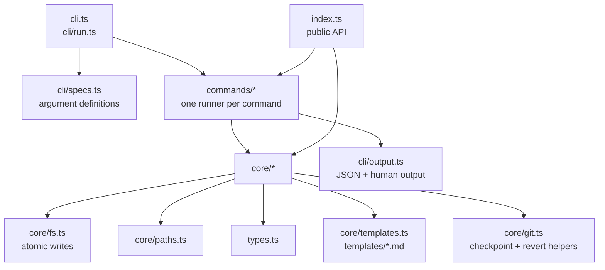

# Architecture

SpecVibe is a TypeScript ESM CLI with no runtime dependencies. The CLI is a thin adapter over a set of pure-ish core modules that read and write plain Markdown and JSON.

This document is for contributors. It explains the module boundaries, the persistence model, the safety mechanisms, and the testing strategy.

## Module graph



| Layer | Responsibility |
| --- | --- |
| `src/cli.ts` | Process entry point. Reads `process.argv`, calls `runCli`, sets the exit code. |
| `src/cli/` | Argument parsing, global flags, command specs, help, JSON/human output, error rendering. |
| `src/commands/` | One runner per command. Orchestrates core modules, handles command-specific flags, emits output. |
| `src/core/` | Domain logic. No command-line parsing, except shared errors. |
| `src/types.ts` | Shared domain types and canonical constants (`AGENT_IDS`, `TRACK_STATUSES`). |
| `templates/` | User-facing generated documents and agent instruction bodies. |
| `src/index.ts` | Public library surface, re-exporting core modules and `runCli`. |

Dependency direction: `cli → commands → core`. Core modules do not import commands. `index.ts` re-exports both core and selected commands for programmatic use.

## Command flow

Every command follows the same path:

```text
argv
  → splitLeadingGlobals()
  → findCommandSpec()
  → parseFlags(spec.flags + GLOBAL_FLAGS)
  → resolveCwd(--cwd)
  → requireProjectRoot() (except init, setup, doctor)
  → build CommandContext
  → RUNNERS[command](context)
  → emit JSON or human output
  → return exit code
```

`CommandContext` carries the resolved root, flags, positionals, logger, and output mode. Command runners return an optional exit code; thrown `SpecVibeError` instances become stable error payloads and exit codes.

Output is centralized:

- `emit()` prints JSON in `--json` mode, otherwise calls a human renderer.
- `approve --check` differs intentionally: validation failure is a result, not a thrown error, so it prints to stdout with `ok: false`.
- Errors are printed to stderr. JSON errors include a stable `code`, `message`, `hint`, and optional `details`.

## Persistence model

All state is local and human-readable.

### `.specvibe/config.json`

Normalized configuration, validated on every load. Unknown fields are preserved. See [Configuration](configuration.md).

### `.specvibe/state.json`

```json
{
  "version": 1,
  "activeTrack": "add-csv-export",
  "lastScan": {
    "at": "2026-11-14T12:00:00.000Z",
    "files": 412,
    "sourceFiles": 233,
    "languages": ["TypeScript", "CSS"],
    "commit": "abc123..."
  },
  "lastPack": {
    "at": "2026-11-14T12:05:00.000Z",
    "track": "add-csv-export",
    "path": ".specvibe/packs/add-csv-export.md",
    "estimatedTokens": 18420
  },
  "history": [
    { "at": "2026-11-14T11:50:00.000Z", "event": "proposed", "track": "add-csv-export" },
    { "at": "2026-11-14T11:55:00.000Z", "event": "approved", "track": "add-csv-export" }
  ]
}
```

History is append-only in practice. It records `init`, `setup`, `proposed`, `approved`, `checkpoint`, `task_completed`, `acceptance_verified`, `unified`, and `reverted`.

### `.specvibe/tracks/<slug>/meta.json`

```json
{
  "version": 1,
  "slug": "add-csv-export",
  "title": "Add CSV export to the reports page",
  "status": "applying",
  "createdAt": "2026-11-14T11:50:00.000Z",
  "updatedAt": "2026-11-14T12:01:00.000Z",
  "approvedAt": "2026-11-14T11:55:00.000Z",
  "appliedAt": "2026-11-14T12:01:00.000Z",
  "baseCommit": "0f1e2d...",
  "checkpoint": {
    "commit": "0f1e2d...",
    "ref": "refs/specvibe/checkpoints/add-csv-export/20261114-120100",
    "createdAt": "2026-11-14T12:01:00.000Z",
    "dirtyAtCheckpoint": false
  },
  "relevantFiles": [
    {
      "path": "src/reports/export.ts",
      "score": 8.5,
      "reasons": ["filename match", "exported symbol match"]
    }
  ],
  "forced": false
}
```

`meta.json` is the source of truth for status and checkpoints. Documents store the human plan; metadata stores the lifecycle.

### `.specvibe/context/scan.json`

A complete machine-readable index: project info, limits, stats, files (`path`, `language`, `lines`, `codeLines`, `bytes`, `exports`, `imports`, `inbound`, `isTest`, `isEntry`), directories, bloated files, long functions, possible orphans, unused exports, focus matches, and warnings.

It is written with stable ordering and no timestamps inside individual file records, so diffs stay reviewable. `generatedAt` changes on every scan.

### Markdown documents

`constitution.md`, `context.md`, `decisions.md`, track documents, and summaries are plain Markdown. The parser in `core/markdown.ts` is deliberately small:

- `findSection()` locates a heading and returns content until the next heading of the same level.
- `parseChecklist()` extracts `- [ ] ID — text` items and infers kinds (`task`, `gate`, `completion`, `acceptance`, `decision`, `generic`).
- `toggleChecklistItem()` updates one item by ID, optionally within a section.
- `markdownTable()` and `stripMarkdown()` support summaries and generated output.

No Markdown AST is required, which keeps the dependency count at zero.

## Track lifecycle

```text
proposed → approved → applying → unified
                         └──────→ reverted
```

| Transition | Guard |
| --- | --- |
| `propose` | Slug must not exist. Documents are rendered from templates. |
| `approve` | Status must be `proposed`; validation must pass unless `--force`. |
| `apply` | Status must be `approved`; git and cleanliness requirements unless bypassed. |
| `--done` | Item must exist, be unchecked, and be next unless `--force`. Gates require `--confirm-gate`. |
| `--accept` | Criterion must exist in the `Acceptance Criteria` section. |
| `unify` | Status must be `applying`; all tasks, gates, completion items, and acceptance criteria must be checked unless `--force`. |
| `revert` | Status must be `applying`; a real checkpoint must exist; `--yes` required. |

Archive names are `<date>-<slug>`, with `-2`, `-3`, and so on if a same-day archive already exists. The track is moved, not copied, after writing its final metadata.

Unified and reverted tracks are immutable. Follow-up work gets a new slug.

## Validation

`validateTrackDocuments()` is a pure function over the four documents. It produces structured issues with severity, code, file, and line. Approval and unify both use it.

Important rules:

- Empty documents are errors.
- Unresolved `{{VAR}}` and `[NEEDS CLARIFICATION]` markers are errors.
- `spec.md` must have an `Acceptance Criteria` section with at least one ID-bearing item.
- `tasks.md` must have at least one `G`-prefixed gate.
- Duplicate checklist IDs are errors.
- Very short documents produce warnings.

Validation is intentionally conservative. False positives are cheaper than an agent implementing an ambiguous plan.

## Git safety

Relevant refs:

```text
refs/specvibe/checkpoints/<slug>/<utc-stamp>
refs/heads/specvibe-backup/<slug>-<utc-stamp>
refs/stash
```

Apply:

1. Verify the repo and HEAD.
2. Check the working tree with SpecVibe bookkeeping excluded.
3. Create a checkpoint ref at HEAD when `git.autoCheckpoint` is true.
4. Store the commit, ref, timestamp, and dirty state.

Revert:

1. Resolve the checkpoint ref, falling back to the commit SHA.
2. Collect commits since, changed files, and dirty entries.
3. Without `--yes`, print the plan and stop.
4. Snapshot track documents.
5. Create a backup branch at HEAD.
6. Stash dirty and untracked changes.
7. Reset hard to the checkpoint.
8. Restore the track snapshot, archive as `reverted`, and log recovery details.

All git commands use `execFile` with argument arrays, not shell strings. Paths are passed as separate arguments. Errors include the backup branch and stash when recovery is still possible.

The cleanliness check exempts `.specvibe/` because propose, approve, task updates, and context packs constantly rewrite bookkeeping. Real source changes still block apply.

## Scanner

The scanner walks the repository once, applying:

1. Hard-ignored directories
2. `.gitignore` rules
3. `.specvibeignore` rules
4. `scan.ignore` patterns
5. File count limit
6. File size limit
7. Binary/content checks

For text files it records language, line counts, code lines, exports, imports, test/entry classification, and inbound references. It then derives:

- language and directory stats
- files above `maxFileLines`
- functions above `maxFunctionLines`
- possible orphans (files with no inbound references)
- unused exports (heuristic)
- focus scores from filename, path, symbol, and import matches

The walk is concurrency-limited (`mapLimit`, 32 files) to avoid exhausting file handles on large repositories.

Focus scoring combines signals such as path/title terms, exports, imports, entry-point status, and neighbor connections. Results are capped and sorted deterministically so packs and plans are reproducible.

## Context packer

`packContext()` composes a Markdown document in priority order:

1. Constitution
2. Project context
3. Decisions
4. Track documents (proposal, spec, design, tasks)
5. Codebase map
6. Source files

Budgets are per-section percentages of half the total budget, plus per-file and file-count caps. Documents and files are truncated with an explicit marker. Files that do not fit are listed under "Omitted or truncated."

Candidate source files come from:

- `meta.relevantFiles`
- path-like tokens in track documents
- the latest scan's focus list
- if no track and no focus: the most connected project files

Token estimation is dependency-free (`estimateTokens`): ASCII characters / 4 plus one token per wide/CJK character. It is an estimate, not a tokenizer. The pack always reports that it is estimated.

## Templates

Templates live in `templates/` and use `{{UPPER_SNAKE_CASE}}` variables. `renderTemplate()` reads from the package root, renders variables, and leaves unknown placeholders intact so validation can catch them.

Templates are shipped in the npm package via the `files` field. The build does not compile or modify them.

Track templates include placeholder tasks with `[NEEDS CLARIFICATION]` markers so a generated track can never be approved by accident.

## Cross-platform behavior

- Paths use `node:path`; display paths are converted to POSIX separators.
- Git refs sanitize slugs and use UTC timestamps.
- Writes are atomic: write a sibling temp file, then rename. On Windows, rename failure only occurs if the target is locked, in which case the temp file is cleaned up.
- Slugs are ASCII, lowercase, length-limited, and avoid Windows reserved device names (`con`, `nul`, `com1`, etc.).
- No shell interpolation is used for git or file operations.
- The test suite runs the same lifecycle on Windows and Unix in CI.

## Error model

`SpecVibeError` carries a stable code, a user-facing message, an optional hint, optional structured details, and an exit code.

| Code group | Exit | Examples |
| --- | --- | --- |
| Usage | 2 | unknown command/option, missing value |
| I/O | 1 | unreadable/writable paths |
| Config/state/setup | 3 | invalid config, not initialized, already initialized, track not found, validation failed |
| Safety/state | 4 | invalid transition, dirty tree, git required |
| Git execution | 5 | reset failed, checkpoint missing |
| Internal | 1 | unexpected bug |

Command runners should throw `SpecVibeError` for expected failures and let unexpected errors bubble up, so `--debug` can show a stack trace.

## Testing strategy

The suite uses Vitest with real temporary directories:

- **Unit tests** cover arguments, Markdown parsing, slugs, configuration normalization, scanning, track validation/progression, packing, and agent file generation.
- **CLI tests** call `runCli()` with captured stdout/stderr and assert JSON payloads, exit codes, and on-disk effects.
- **Lifecycle tests** initialize a real git repository, propose a track, fill valid documents, approve, apply, complete tasks/gates/acceptance, unify, and verify the archive/decisions.
- **Safety tests** cover dirty-tree blocking, approval requirements, task ordering, gate confirmation, and revert preconditions.

Guidelines:

- No network.
- No global git configuration changes; set `user.name` and `user.email` locally.
- Clean up temp directories.
- Prefer deterministic assertions over snapshots.
- Add a regression test with every bug fix.

## Extending SpecVibe

Common extension points:

| Change | Where |
| --- | --- |
| New CLI flag | `src/cli/specs.ts`, command runner |
| New command | `src/commands/`, `RUNNERS`, `COMMAND_SPECS`, tests, docs |
| New agent host | `src/types.ts` (`AGENT_IDS`), `src/core/agents.ts`, tests, docs |
| New language heuristic | `src/core/scanner.ts`, scanner tests |
| New template | `templates/`, render map, validation tests |
| New public API | `src/index.ts`, README programmatic example |
| New persistent state | `src/types.ts`, state/config modules, migration logic |

Backward compatibility matters: `.specvibe/` is committed user data. Add fields with defaults, tolerate unknown fields, and avoid breaking existing tracks. If a schema change is unavoidable, add a migration and a test for old state.
